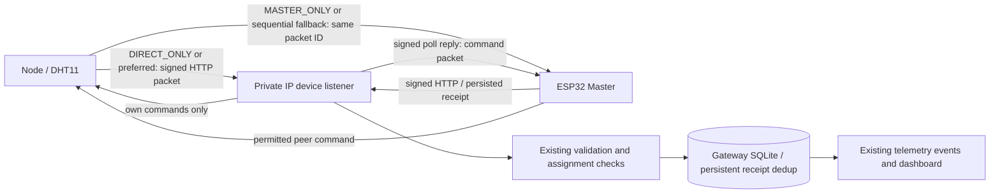

# Local IP Phase A implementation inventory

Contract 1.0.2 / local extension 1; MQTT wire schema, profiles and topics unchanged.

The completed source includes an authenticated HMAC/nonce HTTP listener, persisted listener settings, admin/CSRF configuration, direct-Node permissions, firmware direct/fallback routing, signed receipts, offline clock bootstrap, Master DHT telemetry, bounded raw peer framing, and local diagnostics. Ethernet remains driver-unavailable. OTA/private chat were not extended.

## Files changed

### ESP32_LoRa_ESP32_Firmware

- `CONFIG_CONTRACT.md`
- `docs/LOCAL_IP_AUDIT.md`
- `src/communication/ip_network.h`
- `src/communication/local_ip_auth.h`
- `src/communication/local_ip_core.h`
- `src/communication/transport_manager.cpp`
- `src/communication/transport_manager.h`
- `src/config/config_fields.h`
- `src/config/config_schema.h`
- `src/core/commissioning.cpp`
- `src/core/config_manager.cpp`
- `src/core/network_service.cpp`
- `src/diagnostics/diagnostics_manager.cpp`
- `src/protocol/packet_validation_core.h`
- `src/protocol/protocol.cpp`
- `src/web/local_ip_handlers.cpp`
- `src/web/local_web_server.cpp`
- `src/web/local_web_server.h`
- `test/protocol_host.cpp`
- `test/protocol_stubs/Arduino.h`
- `test/protocol_stubs/WString.h`
- `test/protocol_stubs/esp_system.h`

### ESP32_LoRa_Project

- `CONFIG_CONTRACT.md`
- `backend/configure_local_ip.py`
- `backend/device_api.py`
- `backend/local_ip.py`
- `backend/provision_device.py`
- `backend/server.py`
- `dashboard/static/js/local_ip.js`
- `dashboard/templates/local_ip.html`
- `dashboard/templates/system.html`
- `docs/LOCAL_IP_AUDIT.md`
- `tests/contract_parity.py`
- `tests/gateway_fixture.py`
- `tests/local_ip_parity.py`
- `tests/local_ip_tcp.py`
- `tests/test_local_ip.py`

## Packet flow

## Phase B order

1. PlatformIO build and partition validation (no upload by the build).
2. Gateway unit/API/persistence tests against disposable data.
3. Production C++/Python packet parser/serializer and routing parity; shared contract check.
4. Loopback TCP fragmentation, combined body, malformed/oversized, timeout, auth, restart tests.
5. Inspect laptop adapters/routes/firewall, physical COM8 status and unchanged partition/security details; use actual LAN IP.
6. Physical Master DHT telemetry and safe PING/result, link loss/restart tests where access permits.
7. Mark unavailable second-ESP32/Ethernet/LoRa hardware as BLOCKED. No MQTT integration test.

Source tests and the physical evidence must be reported separately in LOCAL_IP_REPORT.md.

## Final inventory additions

- Firmware root README and build evidence; generated web assets; `tools/local_ip_outage_check.py`.
- Gateway `backend/provision_local_ip.py`, `tests/local_ip_ui.cjs`, `tests/physical_local_ip.py`, README and historical-report pointer.
- Both projects: final report and physical/outage/reboot/secret-scan evidence JSON.
- Protected local credential files and backups are deliberately excluded from source control.
